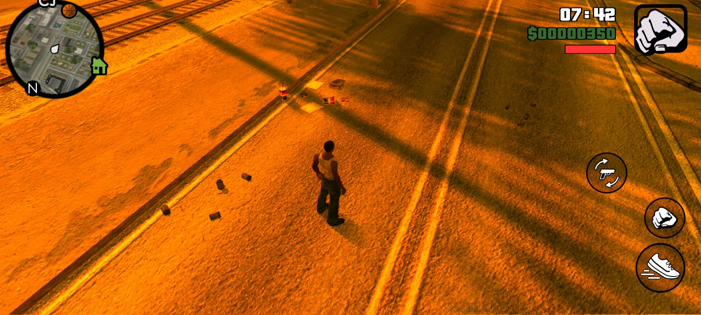
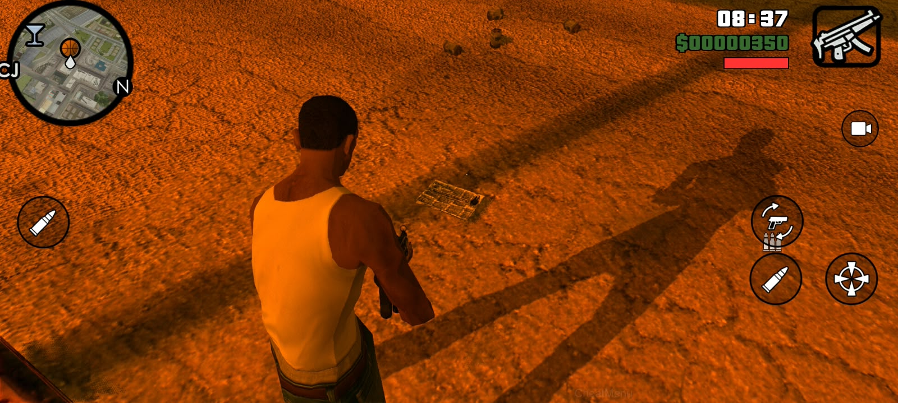
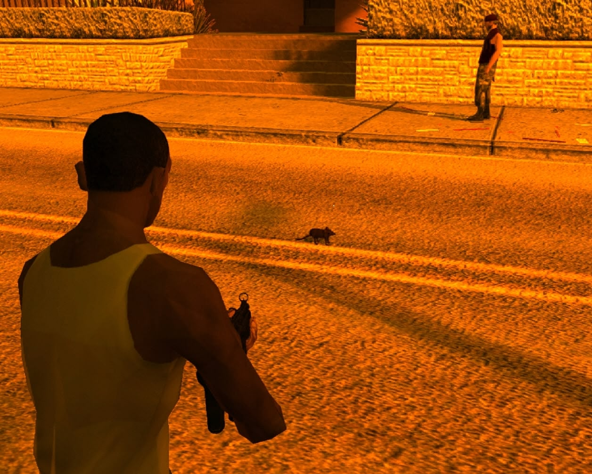

# Rubbish GTA IV 64

AML mod for **GTA: San Andreas Android** that adds roadside litter and loose paper around the player. Paper can drift continuously, flutter down under gravity, settle on the ground, and lift again when a nearby running ped or moving vehicle disturbs it.

> **Status:** experimental. Tested on GTA SA Android 2.10 ARM64 by the project author. Compatibility with other game/AML versions may differ.

## Screenshots

| Roadside litter | Ground paper | Paper on terrain | Rats |
| --- | --- | --- | --- |
|  |  |  |  |

## Features

- Spawns litter around the player, using road nodes and nearby open ground such as grass and roadside areas.
- Spawns a configurable crowd of paper sheets that drift, tumble, and fall under gravity.
- Nearby pedestrians and vehicles can kick paper back into the air; ordinary rubbish has its own lower count limit.
- Paper mix is configurable, with some sheets staying airborne and others landing on the ground.
- Paper collision is disabled, so it does not block or damage passing vehicles.
- Spawns small groups of rats that wander between nearby road-path points.
- Plays a soft three chirp “cit-ci-cit” call near rats. Calls become more frequent as more rats gather nearby, and fade with distance.
- Varies built-in model choice, heading, and object scale.
- Limits the number of spawned objects and removes tracked objects outside the cleanup radius.
- Supports configuration through an AML `.ini` file.

## Requirements

- GTA: San Andreas Android 2.10
- AML (Android Mod Loader) New
- XkiLoader to replace the stock tall-grass model with the rat DFF
- ARM64bit

## Installation

1. Copy `libRubbishGtaIV64.so` into the AML mods folder for the game.
2. Copy `net.dimas.rubbishgtaiv64.ini` to the AML configuration folder.
3. Configure XkiLoader to replace stock model 806 with a DFF named `genVEG_tallgrass.dff` in an enabled mod folder.
4. Copy [`assets/rat/rat_squeak.wav`](assets/rat/rat_squeak.wav) to the GTA SA `files/rat/` directory beside `RubbishRat.log`.
5. Launch the game. If it behaves unexpectedly, check the game's Logcat output and `RubbishRat.log`.

The rat uses stock model ID `806` (`genVEG_tallgrass`) and XkiLoader replaces that model's DFF with the rat mesh. The replacement is global, so stock tall-grass instances will also use the rat mesh while the replacement is enabled. The AML plugin spawns additional moving instances of model 806. Keep `[Rat] ModelId=806` in the INI.

## Configuration

The sample configuration is in [`net.dimas.rubbishgtaiv64.ini`](net.dimas.rubbishgtaiv64.ini). Main settings:

| Section | Setting | Default | Description |
| --- | --- | ---: | --- |
| `General` | `Enabled` | `1` | Enable or disable litter spawning. |
| `General` | `MaxObjects` | `100` | Total tracked object limit. |
| `General` | `MaxRubbishObjects` | `30` | Limit for ordinary road and ground litter. |
| `General` | `MinSpawnDistance` | `28.0` | Minimum player-to-litter distance. |
| `General` | `SpawnRadius` | `70.0` | Maximum spawn radius. |
| `General` | `MinObjectSpacing` | `2.5` | Minimum spacing between litter pieces. |
| `General` | `RoadLateralRange` | `16.0` | Maximum offset from road-path locations. |
| `General` | `CleanupRadius` | `90.0` | Objects beyond this distance are removed. |
| `General` | `SpawnIntervalMs` | `1300` | Delay between ordinary litter spawns. |
| `Models` | `PaperModelId` | `1577` | Game model ID used for paper. |
| `Paper` | `MaxPaperObjects` | `55` | Maximum tracked paper sheets. |
| `Paper` | `SpawnIntervalMs` | `450` | Delay between paper spawn attempts. |
| `Paper` | `ContinuousFlightPercent` | `35` | Chance for paper to keep riding the wind instead of falling. |
| `Rat` | `Enabled` | `1` | Enable or disable rat spawning. |
| `Rat` | `ModelId` | `806` | Stock `genVEG_tallgrass` model replaced by the rat DFF through XkiLoader. |
| `Rat` | `MaxRats` | `5` | Maximum active rats. |
| `Rat` | `SpawnIntervalMs` | `6000` | Delay between rat spawn attempts. |
| `Rat` | `MoveSpeed` | `3.0` | Rat movement speed along nearby road paths. |
| `Rat` | `Scale` | `0.25` | Rat model scale. |
| `Rat` | `HeadingOffset` | `-90.0` | Heading correction in degrees for the replacement DFF's forward axis. |
| `Rat` | `SoundEnabled` | `1` | Enable proximity squeaks. |
| `Rat` | `SoundRadius` | `20.0` | Maximum distance in game units at which rat chirps can be heard. The sound stays quiet and repeats more often when more rats are nearby. |
| `Rat` | `SpawnMinDistance` | `12.0` | Minimum distance from player for a rat spawn. |
| `Rat` | `SpawnRadius` | `48.0` | Maximum rat spawn distance from player. |
| `Rat` | `CleanupRadius` | `90.0` | Remove rats beyond this player distance. |
| `Rat` | `LocalLog` | `1` | Write rat diagnostics to `RubbishRat.log` in the GTA SA Android `files` directory. |

Values are clamped by the mod. Replace `rat_squeak.wav` in the GTA SA `files/rat/` directory with another mono PCM16 WAV (8-48 kHz) to use a different sound. Ordinary litter uses road-path nodes and nearby ground queries, so placement depends on the terrain and available road nodes.
