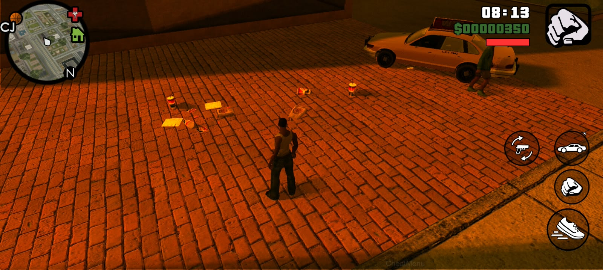

# Road Objects GTA SA Android

AML mod for **GTA: San Andreas Android** that adds decorative litter around the player. It creates objects gradually around nearby road-path locations, with random placement, heading, and scale.

> **Status:** experimental. Tested on GTA SA Android 2.10 ARM64 by the project author. Compatibility with other game/AML versions may differ.

## Screenshots

| Roadside litter                                 | Litter placement                                        |
| ----------------------------------------------- | ------------------------------------------------------- |
|  | ![(Litter placed around the player]](review/review2.jpeg) |

## Features

- Spawns litter within a configurable radius around the player.
- Uses nearby vehicle road-path nodes to choose road and roadside locations.
- Varies built-in model choice, heading, and object scale.
- Limits the number of spawned objects and removes tracked objects outside the cleanup radius.
- Supports configuration through an AML `.ini` file.

## Requirements

- GTA: San Andreas Android 2.10
- AML (Android Mod Loader) New

## Installation

1. Copy `libRoadObjectsGTA4.so` into the AML mods folder for the game.
2. Copy `RoadObjectsGTA4.ini` to the AML configuration folder and name it `RoadObjectsGTA4.ini`.
3. Launch the game. If the game crashes or behaves unexpectedly, remove the mod and check `RoadObjectsGTA4.log` under the Android data directory reported by AML for the game.

## Configuration

The sample configuration is in [`RoadObjectsGTA4.ini.example`](RoadObjectsGTA4.ini.example). Main settings:

| Setting            | Default | Description                                        |
| ------------------ | ------: | -------------------------------------------------- |
| `Enabled`          |     `1` | Enable or disable litter spawning.                 |
| `MaxObjects`       |    `50` | Maximum number of objects tracked by the mod.      |
| `MinSpawnDistance` |  `28.0` | Minimum player-to-spawn distance.                  |
| `SpawnRadius`      |  `70.0` | Maximum spawn radius.                              |
| `MinObjectSpacing` |   `2.5` | Minimum spacing between litter pieces.             |
| `RoadLateralRange` |   `8.0` | Maximum lateral offset from road-path locations.   |
| `CleanupRadius`    |  `90.0` | Distance beyond which tracked objects are removed. |
| `SpawnIntervalMs`  |   `700` | Delay between successful spawns in milliseconds.   |

Values are clamped by the mod. Placement is limited by available game road nodes and ground queries, so litter is not guaranteed to land precisely on every sidewalk.
